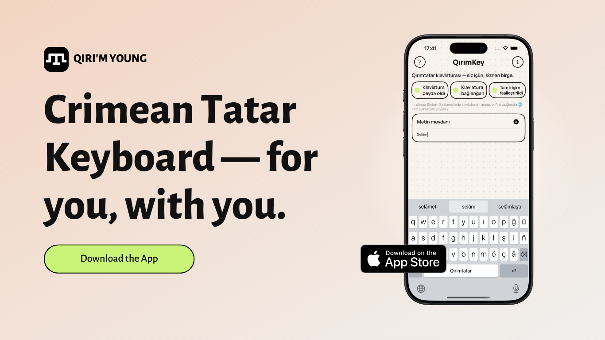

# QırımKey — Crimean Tatar Keyboard for iOS & iPadOS 📱

**QırımKey** is a native-grade iOS and iPadOS keyboard designed specifically for the Crimean Tatar language (`Qırımtatar tili`). It provides both **12-column Latin (`crh-Latn`)** and **Cyrillic (`ФЫВА` / Ukrainian-adapted `ФІВА`)** layouts, live Cyrillic-to-Latin transliteration (`Къ → Q`, `Кʼ → Q`), on-device N-gram autocomplete and autocorrection aligned with the official **2024/2025 Crimean Tatar Orthography** (ДЕСС № 1722/04-03/25), and **QırımKey Swipe v2** gesture typing.

## Key Features

- 🔤 **Latin & Cyrillic Layouts**: Dedicated 12-column Crimean Tatar Latin layout (`q, ğ, ü, ş, ı, ö, ç, ñ`) plus optional Cyrillic (`ФЫВА`) and Ukrainian-adapted Cyrillic (`ФІВА`: `ґ → g · г → ğ · кʼ → q · нʼ → ñ`).
- 🔄 **Live Cyrillic → Latin Transliteration**: Type on the Cyrillic layout while outputting standard Crimean Tatar Latin orthography in real time, with full single-step Backspace (`⌫`) restoration.
- ⚡ **On-Device SQLite N-Gram Autocomplete & Orthography Engine**: Fast unigram/bigram/trigram suggestions, hyphenated compounds (`§ 63`, e.g. `gece-kündüz`, `alış-veriş`), question particle merging (`§ 67`, e.g. `yaptıñ mı → yaptıñmı`), and automatic capitalization of Crimean Tatar toponyms (`Qırım`, `Aqmescit`, `Bağçasaray`, `Çonğar`, `Or Qapı`).
- 〰️ **QırımKey Swipe v2**: Continuous gesture typing on iPhone and iPad Floating keyboards using 16-point resampled SHARK2 trajectory matching, turning-angle anchor weighting ($\Delta\theta \ge 22^\circ$), and Cyrillic `ъ`/`ʼ` corridor cleaning.
- 🌓 **Native iOS / iPadOS 26 & 27 Design**: Zero-shadow keycaps, adaptive Light/Dark Mode synchronization, iPad Docked/Floating/Split support, inline math evaluation (`=`), and culturally authentic Crimean Tatar proverbs.

## Local Development & Code Signing

1. Copy `.env.example` to `.env.local` and `QTatar/Demo/LocalSigning.xcconfig.example` to `QTatar/Demo/LocalSigning.xcconfig` (both local files are gitignored).
2. Open `Keyboard.xcworkspace` or `QTatar/Demo/QTatar.xcodeproj` in Xcode and build the `Demo` scheme for iOS Simulator or your connected device.

## License

Released under the [MIT License](LICENSE). Built on top of the open-source [KeyboardKit](https://github.com/KeyboardKit/KeyboardKit) framework by Daniel Saidi.
